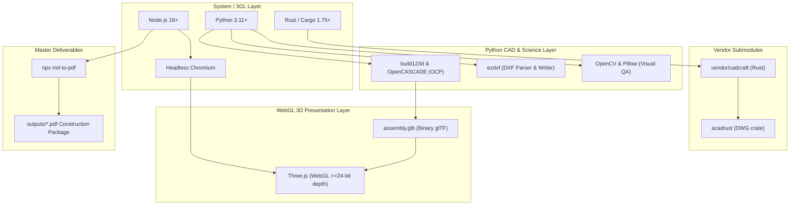

# System Dependencies & Third-Party Requirements

This document highlights the third-generation language (3GL) toolchains, system binaries, external vendor submodules, 3D CAD kernels, and Python runtime dependencies required to run, build, and verify `garden-structure-designer`.

---

## 1. 3GL Runtimes & System Toolchains

`garden-structure-designer` operates an AI-native hybrid pipeline spanning Python orchestrators, a Rust CAD exchange engine, and a Node.js/browser headless loopback rendering harness.

| Toolchain / Runtime | Minimum Version | Recommended | Purpose in Pipeline | Verification Command |
|---|---|---|---|---|
| **Python** | `3.11+` | `3.13+` | Core deterministic math, geometry engine, B-Rep modeling, Stage 0–8 lifecycle | `python3 --version` |
| **Rust / Cargo** | `1.75+` | `1.80+` | Compiling headless `cadcraft-cli` binary from `vendor/cadcraft` submodule | `cargo --version` |
| **Node.js** | `18.0+` | `20.0+` / `26.0+` | Headless WebGL capture loopback, `npx md-to-pdf` document compilation | `node -v` |
| **npm / npx** | `9.0+` | `10.0+` | Package execution for `md-to-pdf` | `npx --version` |
| **Chromium** (via Playwright) | Stable | Managed by Playwright | Headless Chromium execution for WebGL depth testing & SVG computer-vision checks | `python3 -m playwright install --with-deps chromium` |

---

## 2. External Vendor Submodules

### `vendor/cadcraft` (Rust CAD Engine)
- **Repository**: [CADCraft](https://github.com/storytold/cadcraft)
- **Pinned Commit**: `54ea5e743a29acd8f3178cfaa82fb74a38c2de72` (v0.5.0 tag lineage)
- **Git Integration**: Linked as a Git submodule at `vendor/cadcraft/`.
- **License**: Dual-licensed under **MIT** or **Apache-2.0** (with ArtCraft brand trademark restrictions).
- **Transitive Crate**: `acadrust` (MPL-2.0) for DWG exchange.
- **Role in Pipeline**:
  - Headless multi-layer 2D/3D CAD drafting and exchange engine.
  - Compiles the local `cadcraft-cli` binary (`vendor/cadcraft/target/release/cadcraft-cli`).
  - Used for generating production DXFs, validating entities, and converting CAD formats.
- **Build / Initialization**:
  ```bash
  # Initialize and pull submodule
  git submodule update --init --recursive

  # Build the release binary
  python3 scripts/build_cadcraft.py
  # Or natively via cargo:
  cargo build --locked --release -p cadcraft-cli --manifest-path vendor/cadcraft/Cargo.toml
  ```

---

## 3. 3D CAD Kernels & Rendering Libraries (Option C Dual-Path)

To prevent visual sorting artifacts, 2D face popping, and hallucinated framing angles, the project enforces an authoritative 3D solid kernel architecture:

| Library / Engine | Location / Package | License | Role in Pipeline |
|---|---|---|---|
| **build123d** | `build123d>=0.10.0` (PyPI) | Apache-2.0 | Parametric 3D CAD framework used in `cad_backend_build123d.py` to construct B-Rep solid assemblies, compound miters, birdsmouth notches, and export binary glTF (`cad_export_glb.py`). |
| **OpenCASCADE (OCP)** | `cadquery-ocp` (via build123d) | LGPL-2.1 w/ exception | Underlying C++ solid geometry boundary-representation (B-Rep) kernel. Powers `HLRBRep_Algo` in `cad_projection_hlr.py` for occluded vector blueprints (`blueprint-*.svg`). |
| **Three.js** | `presentation_viewer/vendor/three.module.js` | MIT | Embedded WebGL 3D rendering engine. Renders the authoritative solid `assembly.glb` with verified $\ge 24$-bit depth buffering for shaded presentations (`drawing-*.svg`). |
| **GLTFLoader & BufferGeometryUtils** | `presentation_viewer/vendor/` & `presentation_viewer/utils/` | MIT | Browser-side glTF parser and mesh geometry optimization utilities in headless Chromium loopback (`presentation_viewer/viewer.html`). |

---

## 4. Python Ecosystem Dependencies

Python dependencies are strictly managed through `pip-compile` per repository governance rules:
- **Intent file**: `plugins/garden-structure-designer/requirements-core.in`
- **Locked lockfile**: `plugins/garden-structure-designer/requirements-core.txt`

### Key Production Packages

| Package | Minimum / Locked Version | Purpose |
|---|---|---|
| **`build123d`** | `==0.10.0` | Solid CAD modeling kernel & B-Rep geometry builder |
| **`ezdxf`** | `==1.4.4` | DXF file generation, parsing, XDATA tag verification, and layer table compliance |
| **`playwright`** | `==1.60.0` | Headless Chromium loopback capture harness for WebGL depth testing & SVG verification |
| **`opencv-python`** | `==4.13.0.92` | Edge density, contour detection, and visual smoke verification (`visual_svg_smoke_test.py`) |
| **`pillow`** | `==12.2.0` | Image processing, raster dimension assertions, and thumbnail generation |
| **`numpy`** | `==2.4.6` | Vector math, 3D coordinate transformations, and matrix projections |
| **`scipy`** | `==1.17.1` | Scientific calculations, spatial algorithms, and mesh optimizations |

### Installation Instructions

```bash
# In your Python virtual environment:
pip install -r plugins/garden-structure-designer/requirements-core.txt

# Install Playwright browser binaries:
python3 -m playwright install --with-deps chromium
```

> **Note**: Manual `pip install <package>` is prohibited in this repository. To add or upgrade packages, update `plugins/garden-structure-designer/requirements-core.in` and recompile using `pip-compile`.

---

## 5. Document & Master Package Compilation

| Dependency | Invocation | Purpose |
|---|---|---|
| **`md-to-pdf`** | `npx -y md-to-pdf` (Node.js) | Compiles the standalone embedded markdown package (`pergola_plan_embedded.md` or `gazebo_plan_embedded.md`) into the master architectural construction PDF (`compile_package.py`). |

---

## 6. Dependency Map Summary


