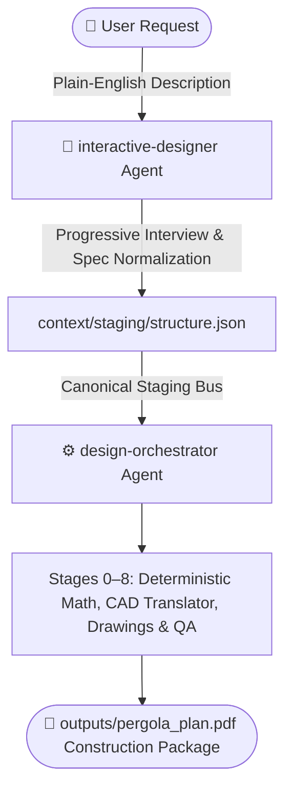

# Garden Structure Designer

> **AI-native multi-agent design pipeline that converts colloquial descriptions of garden structures into professional-grade structural construction PDF packages.**

[](https://github.com/richfrem/agent-plugins-skills)
[](https://www.python.org/)

---

## 🏗️ What It Does

`garden-structure-designer` acts as your personal master timber framer. It conducts an interactive interview to understand your vision (*"a 14ft hexagonal cedar gazebo with steep roof and decorative knee braces in Victoria, BC"*), resolves regional building codes, solves exact 3D geometry and compound miters through deterministic Python engines, generates 8 dimensioned architectural SVG sheets, runs adversarial physics and drawing QA, and compiles a comprehensive PDF package complete with cut-lists and step-by-step assembly guides.



---

## 🚪 Quick Start

### For End Users & Clients
Start your design journey by talking to the **`interactive-designer`** agent:
> *"I want to design a 14ft hexagonal cedar gazebo with steep roof, decorative knee braces, and sonotube footings in Victoria, BC."*

The agent guides the conversation with progressive disclosure, normalizes specifications, and hands off execution to the backend orchestrator.

### For Developers & Automated Workflows
If you already have a structured design specification in `context/staging/structure.json`:
```bash
# Regenerate all 8 architectural and blueprint SVG drawings
python3 plugins/garden-structure-designer/scripts/render_drawings.py context/staging/structure.json

# Compile the complete builder documents and master PDF package
python3 plugins/garden-structure-designer/scripts/compile_package.py
```

---

## 📐 Deterministic CAD Kernel & Integrity Invariants

Unlike typical AI assistants that guess geometry or hallucinate cut angles:
- **Zero Hallucinated Math**: Roof pitches, compound miter cuts, and beam spans are calculated deterministically by `geometry_engine.py`.
- **3D Solid Geometry Kernel**: Visual drawings are projected via `cad_scene.py` using face-depth sorted painter's algorithm projection.
- **Traceable Member IDs**: Every structural component carries a stable, immutable identifier (`P1`, `B1`, `R1`, `HUB`, `FT1`, `Brace1a`) synced across JSON models, SVG `data-tag` attributes, and QA reports.
- **Adversarial Red-Team QA**: Drawing generators cannot certify their own work; `drawing-red-team-agent` independently validates builder-usefulness (`may_claim_success: true` gate).
- **Computer Vision Verification**: Headless Chromium and OpenCV transforms verify SVG topology against structural expectations to ensure zero blank or corrupted views.

---

## 📚 Documentation & Architecture

- **[System Architecture](architecture.md)**: Comprehensive deep dive into Stages 0–8, deterministic engines, validation layers, and data flows.
- **[Architecture Diagrams](docs/architecture/diagrams/README.md)**: Visual Mermaid diagrams illustrating CLI orchestration, plugin architecture, and vendor engine boundaries ([System Overview](docs/architecture/diagrams/cli_plugin_vendor_architecture.mmd) & [Execution Sequence](docs/architecture/diagrams/runtime_execution_sequence.mmd)).
- **[Agent Root Instructions](AGENTS.md)**: Universal behavioral guidelines (Karpathy principles), CAD invariants, and non-negotiables.
- **[Agent Bootstrap & Triage](INIT_AGENTS.md)**: Installation commands, setup procedures, and the Stop-and-Diagnose protocol.
- **[Attribution & Licenses](ATTRIBUTION.md)**: Third-party open-source components, including CADCraft (`vendor/cadcraft`) and acadrust.

---

## 📦 Installation

### Via `uvx` (Antigravity / CLI environments)
```bash
# Install all plugins from the catalog
uvx --from git+https://github.com/richfrem/agent-plugins-skills plugin-add plugins/ --all -y

# Install the garden structure plugin directly
uvx --from git+https://github.com/richfrem/garden-structure-designer plugin-add richfrem/garden-structure-designer
```

### Via Claude Code Marketplace
```bash
# Register marketplace and install
/plugin marketplace add richfrem/garden-structure-designer
/plugin install garden-structure-designer
```

---

## 📄 Construction Package Deliverables

A completed revision outputs the following production deliverables:

| Deliverable | Path | Description |
|---|---|---|
| **Master PDF** | `outputs/pergola_plan.pdf` | Fully compiled construction packet with drawings & specs |
| **Builder Guide** | `outputs/pergola_plan.md` | Assembly sequence, fasteners, and framing instructions |
| **Cut Schedule** | `outputs/fabrication/cut-list.json` | Exact timber cut lengths, miter angles, and board footage |
| **Drawings (SVG)** | `outputs/drawing-*.svg` | Plan, elevation, perspective, and isometric projection views |
| **Blueprints (SVG)**| `outputs/blueprint-*.svg` | Dimensioned fabrication and component isolation shop sheets |
| **QA Dashboard** | `outputs/quality-dashboard.md` | Deterministic verification status and physics clearances |
