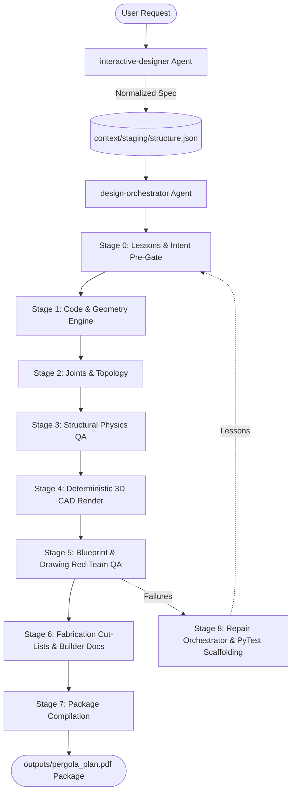

# Architecture & System Design

## Overview
`garden-structure-designer` is an AI-native multi-agent design pipeline that converts colloquial descriptions of garden structures (pergolas, gazebos, pavilions) into professional-grade structural construction PDF packages.

The pipeline uses `context/staging/structure.json` as the sole canonical data bus.



---

## 1. System Topology & Points of Entry

### Front-Door Conversational UI
- **`interactive-designer`**: The conversational agent. It uses progressive disclosure to interview users (*"chunky rustic gazebo with steep roof in Victoria, BC"*), resolves location wind/snow loads, translates colloquial inputs into formal constraints, and writes `context/staging/structure.json`.

### Non-Interactive Orchestration Engine
- **`design-orchestrator`**: The backend orchestrator. Drives sequential fail-closed execution across Stages 0 through 8.

---

## 2. Fail-Closed Pipeline Lifecycle (Stages 0–8)

| Stage | Name | Key Scripts / Skills | Output Artifacts | Exit Gate |
|---|---|---|---|---|
| **0** | **Self-Healing & Intent Pre-Gate** | `load_applicable_lessons.py`, `validate_intent.py` | Staging intent report | All 15 required structural keys verified. |
| **1** | **Building Code & Math Engine** | `building-code-validator`, `geometry_engine.py` | `geometry-calculations.json` | Exact 3D vertices, roof pitches, beam miter angles calculated. |
| **1.5** | **CAD Constraint Translation** | `cad_language_translator.py` | Reference planes & member constraints | Formal assembly coordinates verified. |
| **2** | **Connections & Topology** | `joinery-designer`, `bracing-system-designer`, `topology_compiler.py` | `geometry.joints.topology` | Load paths and member-connection graph compiled. Model locked. |
| **3** | **Physics Validation** | `structural_physics_validator.py` | `physics-validation-report.json` | $L/d \le 50$ (slenderness), $L/240$ (deflection), footing bearing PASS. |
| **4** | **3D CAD Drawing Generation** | `render_drawings.py`, `cut_list_engine.py` | 8 SVG sheets, `SB01-cut-list.json` | Semantic SVG elements rendered with `data-role` and `data-tag`. |
| **5** | **Blueprint QA & Red-Team Gate** | `validation-agent`, `drawing_content_validator.py`, `run_drawing_red_team.py` | `drawing-red-team-report.json` | Adversarial Red-Team Gate: `may_claim_success: true` strictly required. |
| **5.5–5.6** | **Visual Smoke & Computer Vision** | `cross_artifact_validator.py`, `visual_svg_smoke_test.py` | Headless Chromium raster checks | OpenCV edge/Hough transform topology match; no blank or cluttered sheets. |
| **6** | **Fabrication & Builder Documents** | `fabrication_builder.py`, `builder_docs_compiler.py` | `outputs/fabrication/cut-list.json`, assembly guide, bill of materials | Tripod-first assembly sequence and accurate board footage verified. |
| **7** | **Master Package Compilation** | `package_consistency_validator.py`, `compile_package.py` | `outputs/pergola_plan.md`, `outputs/pergola_plan.pdf` | Final asset embedding and PDF compilation. |
| **8** | **Learning & Regression Capture** | `repair_orchestrator.py`, `failure_to_test.py` | `learning-registry.json`, `tests/test_regressions.py` | Captures failure lessons and scaffolds automated PyTest fixtures. |

---

## 3. The Deterministic Kernel

Geometry, cut angles, and physics are **strictly deterministic Python operations**. LLMs provide inputs and styling, but never calculate geometry:

- **`geometry_engine.py`**: Computes roof pitches, compound miter cuts, and 3D wireframe coordinates.
- **`cad_scene.py`**: 3D Solid Geometry CAD kernel using face-depth sorted painter's algorithm projection.
- **`cut_list_engine.py`**: Calculates board footage, lumber schedules, and waste allowances.
- **`render_drawings.py`**: Deterministically draws 8 architectural SVG sheets.
- **`structural_physics_validator.py`**: Evaluates empirical structural formulas against regional code requirements.
- **`builder_docs_compiler.py` & `compile_package.py`**: Generates fabrication documents and PDF deliverables.

---

## 4. CAD Debuggability & Integrity Invariants

1. **Stable Member Identifiers**: Every structural member carries an immutable identifier (`P1`, `P2`, `B1`, `B2`, `R1`, `HUB`, `FT1`, `Brace1a`).
2. **Cross-Layer Traceability**: IDs must match identically across `structure.json`, geometry graphs, CAD solid entities, SVG `data-tag` attributes, and error reports.
3. **Semantic SVGs**: Every drawn member embeds `data-role="beam"` and `data-tag="B2"`. Anonymous geometry is prohibited.
4. **Visual Midpoint Labels**: Major framing members must render a visible `→ {ID}` label in every drawing sheet.
5. **Dynamic Derivation**: Shape and member counts are dynamically parsed from `structure.json`. Hardcoded assumptions (e.g. 6 posts, fixed viewport scales) are strictly prohibited.
6. **Stop-and-Diagnose Protocol**: If validation fails or reports conflict, the system halts to classify root causes before any code modification.
7. **Adversarial Red-Team Gate**: A package cannot be certified by its producer. The independent reviewer must approve (`may_claim_success: true`).

---

## 5. Artifact Directory Structure

```text
context/
└── staging/
    ├── structure.json                # Canonical data bus
    ├── structural-model.json         # Locked 3D structural model
    ├── geometry-calculations.json    # Exact solved math & angles
    ├── drawing-red-team-report.json  # Adversarial QA report
    └── learning-registry.json        # Self-healing durable lessons
outputs/
├── drawing-*.svg                     # 4 Architectural projection views
├── blueprint-*.svg                   # 4 Detailed fabrication shop sheets
├── fabrication/cut-list.json         # Precise timber cut schedule
├── pergola_plan.md                   # Formatted builder markdown
└── pergola_plan.pdf                  # Master compiled PDF package
```
