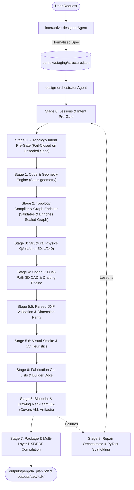

# Architecture & System Design

## Overview
`garden-structure-designer` is an AI-native multi-agent design pipeline that converts colloquial descriptions of garden structures (pergolas, gazebos, pavilions) into professional-grade structural construction PDF packages and precision CAD blueprints.

The pipeline uses `context/staging/structure.json` as the sole canonical data bus.

---

## 1. System Topology & Points of Entry

### Front-Door Conversational UI
- **`interactive-designer`**: The conversational agent. It uses progressive disclosure to interview users (*"chunky rustic gazebo with steep roof in Victoria, BC"*), resolves location wind/snow loads, translates colloquial inputs into formal constraints, and writes `context/staging/structure.json`.

### Non-Interactive Orchestration Engine
- **`design-orchestrator`**: The backend orchestrator. Drives sequential fail-closed execution across Stages 0 through 8.

---

## 2. Fail-Closed Pipeline Lifecycle (Stages 0–8)

| Stage | Name | Key Scripts / Skills | Output Artifacts | Exit Gate |
|---|---|---|---|---|
| **0** | **Self-Healing & Intent Pre-Gate** | `load_applicable_lessons.py`, `validate_intent.py` | Staging intent report | All 15 required structural keys verified. |
| **0.5** | **Topology Intent Pre-Gate** | `validate_topology_intent.py` | Intent validation report | **Anti-Hallucination Gate 0.5**: Validates unsealed intent before geometry math runs. Enforces `RadialHubTopology` ($N \ge 5$). |
| **1** | **Building Code & Math Engine** | `building-code-validator`, `geometry_engine.py` | `geometry-calculations.json` | Exact 3D vertices, roof pitches, beam miter angles calculated. Geometry sealed (`geometry._sealed = true`). |
| **2** | **Connections & Topology Graph Enricher** | `topology_compiler.py`, `joinery-designer` | `geometry.joints.topology` | Post-seal graph enrichment. In-process validation against dangling nodes or duplicate members. Model locked. |
| **3** | **Physics Validation** | `structural_physics_validator.py` | `physics-validation-report.json` | $L/d \le 50$ (slenderness), $L/240$ (deflection), footing bearing PASS. |
| **4** | **3D Solid Kernel & Dual-Path Drafting** | `cad_backend_build123d.py`, `cad_projection_hlr.py`, `presentation_viewer/`, `cad_export_glb.py`, `render_drawings.py` | 8 SVG sheets, `assembly.glb`, candidate DXFs | **Option C Dual-Path Engine**: Solid B-Rep assembly (`build123d`), OpenCASCADE C++ HLR vector blueprints (`blueprint-*.svg`), Three.js WebGL with >=24-bit depth testing for shaded presentations (`drawing-*.svg`), native RH_Z_UP `assembly.glb`. |
| **5.5** | **Parsed DXF Validation** | `cross_artifact_validator.py` | Parsed DXF report | `ezdxf` parsed entity check: 1:1 member ID xdata parity, 3D bounds for SB01, 2D projected XY for SB02. |
| **5.6** | **Visual Smoke & Computer Vision** | `visual_svg_smoke_test.py` | Visual raster report | Headless Chromium raster checks; edge/Hough transform topology match. |
| **6** | **Fabrication & Builder Documents** | `fabrication_builder.py`, `builder_docs_compiler.py` | `outputs/fabrication/cut-list.json`, assembly guide, bill of materials | Tripod-first assembly sequence and accurate board footage verified. |
| **5** | **Blueprint QA & Red-Team Gate** | `validation-agent`, `drawing_content_validator.py`, `run_drawing_red_team.py` | `drawing-red-team-report.json` | Adversarial Red-Team Gate across ALL deliverables (SVGs, DXFs, Cut Lists): `may_claim_success: true` strictly required. |
| **7** | **Master Package Compilation** | `compile_package.py` | `outputs/pergola_plan.pdf`, `outputs/cad/*.dxf` | Final asset embedding, exact byte verification, and PDF compilation. |
| **8** | **Learning & Regression Capture** | `repair_orchestrator.py`, `failure_to_test.py` | `learning-registry.json`, `tests/test_regressions.py` | Captures failure lessons and scaffolds automated PyTest fixtures. |

---

<!-- BEGIN CADCRAFT V1.5 SHARED CONTRACT -->

## C1. Authority, scope, and schema migration

This is the normative v1.4 target contract, not a claim that the current implementation satisfies it. Python owns intent, engineering, coordinates, stable member identities, connections, and fabrication quantities. CADCraft is a subprocess drafting/exchange engine; it must never infer, repair, add, or remove structural members. `context/staging/structure.json` remains the sole canonical data bus. Other JSON files and manifests are derived evidence, never competing model authorities.

Initial production release enables **only `RadialHubTopology`**, regular polygonal gazebos with integer N >= 5. Unsupported secondary framing, irregular footprints, grids, and ridge roofs fail closed. No feature flag may promote unsupported topology into this production release. Grid and ridge implementations require separate later milestones and independent acceptance.

Paths are relative to the repository root. Existing schema is `plugins/garden-structure-designer/schemas/structure.schema.json`; update its generator as well as the generated schema. New fields below are explicit v1.4 additions, not existing capabilities. Continue JSON Schema draft-07 and preserve existing required engineering fields. Use conditional family schemas plus semantic validators for cross-field arithmetic.

| Field | Contract |
|---|---|
| `meta.schema_version` | Target schema discriminator `1.4`; explicit migration required for earlier versions. |
| `meta.topology_family` | Required enum: `RadialHubTopology`, `OrthogonalGridTopology`, `HipRidgeTopology`. Never `metadata.topology_family`. |
| `meta.source_hash` | Retain existing input-hash semantics; not a concurrency token. |
| `meta.revision_id`, `meta.revision_hash` | New committed revision UUID and SHA-256 digest; assigned by transaction authority, not clients. |
| `structure.sides` | Radial integer N >= 5; reserved rectangular families require 4. |
| `layout.post_count` | Authoritative declared post count; radial equals `structure.sides`. No `requested_posts` alias. |
| `roof.primary_rafters.count` | Radial equals N. |
| `hub.type` | Radial exhaustive enum: `hexagonal_prism`, `octagonal_prism`, `polygonal_cylinder`. |
| `geometry.joints.layout.post_count` | Solved count, independently checked against intent and actual arrays. |
| `geometry.joints.layout.post_xy` | Exactly N finite, distinct XY coordinates in feet, ordered around the regular polygon. |
| `geometry.joints.layout.beam_segments` | Exactly N unique beam records with `id`, `i0`, `i1`; indices in [0,N). |
| `geometry.joints.primary_rafters` | Canonical solved rafter array; exactly N unique records with `id`, `start`, `end`, `seat_point`. |
| `geometry.joints.rafters.primary_rafters` | Existing compatibility mirror, if present, must equal canonical array exactly; never a second authority. |
| `geometry.joints.hub.face_planes.planes` | Exactly N records with existing `id` (`H1..HN`), finite 3D `point`, unit `normal`. No implicit `face_id` lookup. |
| `geometry.joints.topology` | Validated graph, generated only by Stage 2 after checking sealed geometry. |

`hexagonal_prism` requires N=6; `octagonal_prism` requires N=8; `polygonal_cylinder` requires N>=5 and means an N-faced regular polygonal prism, not a smooth cylinder. Solved hub type equals intent; one unique face serves each primary rafter. No missing or unknown hub type defaults. Radius, height, clearance, orientation, timber dimensions, footings, and code inputs must be explicit or deterministically solved from explicitly supplied constraints, with provenance. Never supply silent structural defaults.

Migration must validate input, report proposed changes, and commit through C5. It may normalize known schema aliases only when unambiguous; conflicting aliases fail. Legacy `K1A` brace identifiers must be preserved through all artifacts or migrated with an explicit bijective ID map invalidating all derivatives. New radial braces use `Brace1a`, `Brace1b`, …, `BraceNa`, `BraceNb`. A rerun preserves IDs; IDs are not reassigned by drawing order.

Reserved family schemas are discriminated by `meta.topology_family` and reject unknown fields inside their family-specific objects:

| Family | Required reserved input schema | Semantic conditions and runtime behavior |
|---|---|---|
| `OrthogonalGridTopology` | `structure.sides=4`; `structure.shape` in `square,rectangle`; `layout.grid` object: `rows`, `cols` integers >=2; `row_spacing_ft`, `col_spacing_ft` finite numbers >0; `roof.rafter_spacing_ft`, `roof.max_rafter_spacing_ft` numbers >0; `hub.type="none"`. | `layout.post_count=rows*cols`; spacing <= max; grid coordinates and beam adjacency are future work. Shape `square` requires equal overall dimensions. Valid schema still returns `TOPOLOGY_NOT_IMPLEMENTED`. |
| `HipRidgeTopology` | `structure.sides=4`; `structure.shape="rectangle"`; `layout.length_ft`, `layout.width_ft` numbers >0; `layout.midspan_posts` array (may be empty) of objects `{id:string, edge: north/east/south/west, t:number strictly between 0 and 1}`; `roof.ridge` object `{member_id:"RIDGE", axis:"x", length_ft:number>0}`; positive `roof.rafter_spacing_ft`, `roof.max_rafter_spacing_ft`; `hub.type="none"`. | `layout.post_count=4+len(midspan_posts)`; unique IDs exclude `P1..P4`; no duplicate edge/t pair; ridge length < layout length; spacing <= max. Four corner posts, one ridge, four hips reserved. Valid schema still returns `TOPOLOGY_NOT_IMPLEMENTED`. |

Conditional schema branches must relax radial-only radius, hub sizing, and primary-rafter-count requirements for these reserved shapes; validators must not demand fabricated radial fields. Stage 0.5 validates shape/schema then rejects both reserved families. Stage 2 independently rejects them even if invoked directly with forged seals. Unknown families return `UNKNOWN_TOPOLOGY`. No geometry, renderer, or exporter runs after these rejections.

## C2. Two-stage topology and attachment contract
### C2.1 Structured Error Code Registry
Stage 0.5 and Stage 2 emit structured errors with explicit codes:
| Error Code | Stage | Cause |
|---|---|---|
| `TOPOLOGY_CARDINALITY_MISMATCH` | Stage 0.5 / 2 | Declared or solved member count does not equal required family N. |
| `DUPLICATE_MEMBER_ID` | Stage 2 | Multiple members share the same immutable identifier (e.g., two `B1` beams). |
| `DANGLING_CONNECTION_ENDPOINT` | Stage 2 | A connection `from` or `to` references a nonexistent member or attachment. |
| `ATTACHMENT_GEOMETRY_MISMATCH` | Stage 2 | Resolved attachment points on adjacent members diverge beyond geometric tolerance. |
| `UNKNOWN_TOPOLOGY_FAMILY` | Stage 0.5 / 2 | The declared `meta.topology_family` is not recognized. |
| `TOPOLOGY_NOT_IMPLEMENTED` | Stage 0.5 / 2 | Reserved family (`OrthogonalGridTopology`, `HipRidgeTopology`) requested before implementation milestone. |
| `STALE_REVISION` | Stage 5 CAS | `base_revision_hash` does not match active canonical hash at commit time. |

Stage 0 validates complete intent and confirmed jurisdiction/load inputs before structural calculations. Stage 0.5 checks the unsealed family schema and declared equalities. Stage 1 deterministically solves geometry and sets `geometry._sealed=true`. Stage 2 validates actual solved arrays before building a graph; seals are insufficient evidence by themselves. Stage 3 validates structural physics and jurisdiction-specific engineering requirements; L/d and L/240 checks do not replace the complete applicable design checks.

For radial models Stage 2 requires:

- `structure.sides == layout.post_count == geometry.joints.layout.post_count == len(post_xy) == N`, plus N unique graph posts `P1..PN`, N perimeter beams `B1..BN`, N primary rafters `R1..RN`, and one `HUB`.
- Actual post XY points form a regular polygon within the configured geometric tolerance: equal radii and angular intervals, ordered consistently, no coincident points or crossing perimeter edges. Coordinates must be finite; NaN and infinity fail.
- Beam Bi joins Pi to P((i mod N)+1), including the closing edge. Every primary rafter has a seat connection over Pi and an inner connection on hub face Hi. Tail overhang is physical geometry, not a disconnected graph endpoint.
- Enabled perimeter knee bracing requires `bracing.brace.count_per_post=2`, exactly 2N resolved brace records and two attachments each; disabled bracing requires zero. Unsupported brace layouts fail. Exactly N declared/solved footings `FT1..FTN`, one under each post, with validated bearing connections. No unaccounted secondary rafters or purlins: enabled secondary framing returns `FEATURE_NOT_IMPLEMENTED` for this release.
- Compare actual arrays and graph sets, not merely cached count scalars. Reject duplicate member IDs, duplicate edges, missing members, extra members, orphan components, absent connections, invalid face references, zero-length solids, invalid normals, and attachments outside their parent surfaces.
- Do not use `geometry.joints.rafters.primary_count` as an authority: the current geometry producer emits actual primary-rafter arrays. Do not repair count drift by truncation, padding, regeneration, or relaxed assertions in Stage 2.

New graph member records retain `id` and `type` and add `attachments`: an object keyed by stable attachment name. Each attachment requires `{kind, point_ft:[x,y,z], normal:[x,y,z]}`; kind enum is `endpoint`, `seat`, `face`, `footing_bearing`. Each connection retains parent-member `from` and `to` IDs and adds typed `from_attachment` and `to_attachment` objects, each `{member_id:string, attachment_id:string}`. The corresponding member ID must equal `from`/`to`; resolve the attachment on that parent, validate compatible kinds, and compare the two resolved points within tolerance. Points must lie on the specified parent geometry; a coincident but invented point is invalid.

For example, `RIDGE:west_head` serializes `{member_id:"RIDGE", attachment_id:"west_head"}` and resolves `members[id=RIDGE].attachments.west_head`, kind `endpoint`. `east_head` follows the same rule. These are not additional structural members; `RIDGE_WEST` and `RIDGE_EAST` are invalid dangling IDs. Interior common-rafter seats use named `seat` attachments on RIDGE with explicit solved coordinates and a validated station in [0,1]. Radial examples are `HUB:H1` (face) and `P1:top` (endpoint). This contract is validated independently of whether the ridge family is enabled.

Stage 2 failure returns a structured error with code, stage, expected/observed counts, offending paths and IDs; CLI exits nonzero. It cannot publish a graph or modify the canonical revision. Renderers and exporters do not merely trust static receipt files in staging. Before consuming sealed geometry, each downstream renderer and exporter invokes the lightweight Stage 2 validator in-process on the exact bytes being read, asserting hash parity with the active revision. A forged receipt file cannot bypass this in-process gate.

## C3. CAD boundary, deterministic export, and platforms

Candidate upstream pin is `storytold/cadcraft` commit `54ea5e743a29acd8f3178cfaa82fb74a38c2de72`, at `vendor/cadcraft`. Its existence, CLI targets, supported API, license texts, transitive dependency versions, and font licenses must be verified against that exact checkout in M1A. Prior drafts' CLI/MCP and license assertions are hypotheses until the feasibility evidence is recorded. No unpinned upgrade or automatic remote merge.

All automation entry points are cross-platform Python, including **`scripts/build_cadcraft.py`** and `scripts/constraint_solver_probe.py`; no shell-script build or wrapper dependency. Use `pathlib`, `sys.executable`, subprocess argument arrays, `shell=False`, explicit cwd, bounded output capture and error reporting. Resolve `cadcraft-cli.exe` on Windows and `cadcraft-cli` elsewhere. Test paths containing spaces and Unicode. Build with Cargo's locked dependency mode using the actual verified workspace target; `cargo build --locked --release -p cadcraft-cli --manifest-path vendor/cadcraft/Cargo.toml` is conditional on proving that target exists. If absent, M1A must implement a minimal headless wrapper against the pinned public Rust API and test it; otherwise stop delivery with a no-go decision.

Adapter protocol v1 is owned by this integration: JSON UTF-8 request with `protocol_version`, `revision_id`, `revision_hash`, `sheet_id`, units `mm`, and typed entities; response echoes revision/sheet and returns output digest plus diagnostic status. No arbitrary code, commands, or filesystem paths from a model. Validate payload schema and byte limits. Use a configured 15-second export deadline, terminate and reap child processes on timeout, and reject malformed, truncated, oversized, wrong-version, wrong-revision, or nonzero-exit responses. Build timeout is a separate configurable budget. CLI JSON and MCP support must be implemented/proven, never assumed upstream features.

### C3.1 ExchangeWriter Port & Fallback Architecture
CAD export is encapsulated behind an `ExchangeWriter` port interface owned by `export_cad.py`.
- **Primary Adapter**: `CadcraftAdapter` invokes the compiled `cadcraft-cli` binary.
- **Audited Fallback Adapter**: If CADCraft CLI feasibility fails during M1A or platform crashes occur, `EzdxfAdapter` serves as the fully tested, zero-external-binary fallback writer producing 100% compliant multi-layer DXFs with registered XDATA and layer tables.
- **Port Invariant**: Downstream package compilation and validation depend strictly on the `ExchangeWriter` port contract, ensuring pipeline delivery is never blocked by external Rust build quirks.

`CAD_REQUIRED` is the production default: missing binary, wrong build provenance, unsupported feature, parse failure, or exporter error aborts package generation. Explicit `--allow-no-cad` selects development baseline only; mark every report and package `DEVELOPMENT_BASELINE_NO_CAD`, never production-complete. Python dependencies (including `ezdxf` and the chosen portable locking library if needed) go through project requirements and pip-compile; manual pip installation is not part of this plan. Centralize tolerances, unit conversion (304.8 mm/ft), layer settings, timeouts, and limits in `control_plane/constants.py`.

## C4. Per-sheet CAD and drawing acceptance

The first release uses a wireframe exchange representation with **one top-level INSERT per structural member**, referencing one deterministic block per member per sheet. Block primitives describe the member's solved wireframe/outline, not a new solid-engine claim. Multiple internal LINE/polyline entities are expected; raw DXF entity count is not member count. Each INSERT carries registered APPID `GSD` XDATA strings `MEMBER_ID=<id>`, `REVISION_ID=<uuid>`, `REVISION_HASH=<sha256>`, `SHEET_ID=<sheet>`, `ROLE=<role>`. Internal primitives inherit the role layer explicitly; no untagged top-level structural extras. Annotations/dimensions carry source-member references and revision metadata but do not count as structural instances. Sidecar manifests enumerate member IDs, block names, expected primitive types and geometry digest, sheet bounds and file SHA-256.

| Model role / ID | DXF layer | ACI color |
|---|---|---|
| post / `P*` | `FRAMING_POSTS` | 1 |
| beam / `B*` | `FRAMING_BEAMS` | 3 |
| primary rafter / `R*` | `FRAMING_RAFTERS` | 4 |
| hub / `HUB` | **`FRAMING_HUBS`** | 6 |
| brace / `Brace*` (or preserved legacy K IDs) | **`FRAMING_BRACES`** | 5 |
| footing / `FT*` | `FOOTINGS_PIERS` | 8 |
| dimension | `DIMENSIONS_ARCH` | 2 |
| label / annotation | `ANNOTATIONS` | 7 |

All structural members occur once on both sheets, even when projection overlaps. Use wireframe extents for vertical posts/footings in plan, not zero-length projected centerlines. Do not deduplicate coincident members. Helpers are nonstructural and explicitly typed. No ridge layer is needed before its later milestone.

| Sheet | Geometry and units | Acceptance bounds |
|---|---|---|
| `SB01-structure.dxf` | WCS right-handed model XYZ, Z up, full-scale mm, `$INSUNITS=4`. | Compare min/max X, Y **and Z** of transformed structural block primitives with the canonical solved wireframe's 3D bounds, including HUB, braces and footings. |
| `SB02-plan.dxf` | Orthographic projection `(x,y,z)->(x,y,0)`, same origin, full-scale mm, `$INSUNITS=4`; no paper-scale coordinates. | Compare min/max X and Y with the **projected XY** bounds of the same wireframe; every structural vertex has Z=0 within tolerance. Never compare plan Z to 3D roof height. |

Round-trip acceptance uses `ezdxf.readfile`, its auditor, modelspace queries, INSERT transforms, expanded block geometry and XDATA parsing. Assert zero auditor errors (no silent repair), exact top-level member-ID multiset equality, one INSERT per expected member, no duplicate or unknown IDs, correct revision, correct role layer/color, finite coordinates, declared primitive counts/types, per-member geometry/attachment landmarks and sheet bounds. Maximum absolute coordinate/bounds error is **0.01 mm** against the sealed solved geometry after unit conversion, not unrounded design intent; export must not introduce a second rounding step. Missing XDATA, missing registered APPID, wrong units, malformed blocks, extra top-level structural primitives, flattened SB01, nonplanar SB02, or layer-swapped HUB/braces fail. Aggregate bounds alone cannot detect swapped/moved members; per-member comparisons are mandatory. Compare measured DIMENSION values and source references to solved spans; text overrides cannot conceal incorrect geometry.

Stage 4 creates all eight SVG sheets and the two candidate DXFs. Every rendered SVG element has `data-role` and `data-tag` (nonmember annotations use stable annotation IDs and explicit source references); every major member has a visible midpoint label or a clearly linked leader/inset when occluded. No omitted/hidden member passes via an invisible label. Stage 5 obtains independent `drawing-red-team-agent` approval with `may_claim_success:true`. Stage 5.5 invokes the parsed validator on candidate DXFs and cross-artifact IDs/dimensions. Stage 5.6 runs headless Chromium visual smoke checks. Stage 6 produces fabrication cut lists and builder documents. Stage 7 invokes the **same** parsed validator against the exact bytes being packaged, checks all current-revision receipts, and compiles the final PDF. Stage 7 must never silently regenerate drawings after approval; any changed bytes require renewed affected QA and red-team approval. Final package includes structure.json snapshot, SVGs, both DXFs, cut lists, builder Markdown, PDF, revision manifest and approval evidence.

## C5. Transactions, revision identity, and invalidation

All canonical writes (interactive input, CLI, migration, MCP, and repair tools) go through `structure_io.py`'s planned transaction authority; legacy direct-write paths must be removed from operational entry points before release. Mutations are allowlisted patches to intent sections, not arbitrary graph edits. Agents/tools exchange data only through canonical or candidate structure.json. No process-local model state becomes an authority.

Revision hash algorithm `gsd-json-v1`: SHA-256 of UTF-8 JSON with sorted keys, compact separators, ensure_ascii=False and allow_nan=False over the complete canonical document, excluding only `meta.revision_hash` and `meta.updated_at`. `meta.revision_id` is a fresh server UUID included in the hash, preventing ABA when content returns to an earlier value. `meta.source_hash`, lifecycle, family, all inputs, solved geometry, graph, presentation and engineering provenance are included. Normalize supported JSON numeric types before serialization; hash and verify in Python only. Timestamps never authorize a revision. A committed revision is immutable; downstream receipts/artifact paths live outside it and bind to its ID/hash.

1. **Begin**: take a portable interprocess exclusive lock keyed to the canonical structure path; recover unfinished journal entries first; read and verify canonical ID/hash, compare submitted `base_revision_hash`, allocate an unguessable txn UUID, and snapshot. Release lock. Store all work under **`context/staging/candidates/<txn_id>/`**, including `structure.json`, `reports/`, `outputs/`, and `transaction.json`.
Committed deliverables are written to revision-addressed paths **`outputs/.rev/<revision_id>/`** and published atomically via pointer update or filesystem link to `outputs/`, preventing torn files or race conditions with concurrent readers. Reject path traversal, symlink escapes and reused transaction IDs. Capture toolchain/config fingerprints.
2. **Validate candidate**: apply allowlisted patch to the snapshot, clear derived geometry/CAD seals in the candidate only, recompute source hash, run Stages 0/0.5 -> 1 -> 2 -> 3 with explicit candidate paths. No shared staging report/output writes or canonical mutations. Assign candidate revision ID/hash and bind PASS receipts to those exact bytes and the captured fingerprints. Candidate QA failures leave current revision and its valid artifacts unchanged.
3. **Prepare**: stage candidate bytes on the same local filesystem as canonical structure.json; flush/fsync file; record durable transaction journal with old/new ID/hash, candidate digest, invalidation inventory, and state `PREPARED`. Network filesystem execution is unsupported until locking/replacement semantics are proven. Invalid candidate digests or changed toolchain/config invalidate preparation.
4. **Commit-time CAS**: reacquire the same exclusive interprocess lock; recover first; re-read and recompute the current hash **inside the lock**, compare it with `base_revision_hash`, verify candidate digest/receipts again and verify configuration unchanged. Mismatch returns `STALE_REVISION`, preserving canonical state and published artifacts. Both competing writers may validate, but only one can pass this comparison. No check-then-unlocked-replace sequence is allowed.
5. **Publish atomically**: while holding the lock, mark downstream artifacts invalid/unpublished in the durable journal, record `COMMITTING`, use same-filesystem `os.replace` for structure.json, and persist replacement according to tested platform guarantees. Record new active revision and invalidation state. Readers and packagers must take this lock/recovery path before resolving current artifacts; no reader may see old approvals as current. A busy Windows file handle is a recoverable failed commit, never permission to truncate-write the canonical file.
6. **Purge and complete**: under lock, purge the enumerated invalid derived files, persist invalidation completion and journal `COMMITTED`, then release. No success response or new package publication until purge completes. Failure leaves `RECOVERY_REQUIRED` and downstream operations blocked. Keep canonical old/new snapshots and transaction audit records for diagnosis; they are not output caches.

Atomicity guarantee is one canonical pointer/file replacement plus lock-protected reader visibility and recoverable invalidation, **not** fictitious multi-file atomic deletion. Recovery considers strictly journals in state `COMMITTING` (written under the exclusive lock; at most one can exist). For that entry, compare canonical hash with journal old/new: old means roll back to old revision and restore validity only after checking old artifact digests; new means finish purge and receipt promotion idempotently; neither means corruption and fail closed. `PREPARED` journals never trigger crash recovery or pipeline aborts: their owner resolves them at commit time (succeeding or returning `STALE_REVISION`), and orphaned `PREPARED` entries from crashed processes are expired to `ABANDONED` by TTL without touching canonical state or valid artifacts. Test every journal/replacement/purge crash boundary. Startup recovery also removes incomplete temporary derivative outputs. Portable lock behavior, durability semantics and process termination are release-tested on Windows, macOS and Linux; unsupported storage semantics block production.

Every derived artifact manifest contains `revision_id`, `revision_hash`, producer/build/config fingerprint, file digest, and dependency artifact digests. Cache hits require all fields to match the active revision; existence/mtime is never a cache key. A change to any canonical field other than excluded timestamp requires a new revision and **full downstream invalidation**; presentation-only changes also use full invalidation for this release. Toolchain/config changes invalidate all derivative caches and approvals even when structure revision is unchanged. Unversioned legacy artifacts are stale. Failed/stale candidates do not invalidate the winning/current revision's caches.

Required purge inventory (revision-tagged manifest entries plus known unversioned compatibility paths):

| Derived family | Required removal/invalidation |
|---|---|
| Solved staging mirrors | `context/staging/structural-model.json`, `geometry-calculations.json`, CAD/constraint mirrors and derived fabrication JSON; canonical structure.json is never purged. |
| Drawings/CAD | Every generated `outputs/drawing-*.svg`, `outputs/blueprint-*.svg`, other registered SVGs, `outputs/cad/*.dxf`, preview rasters, CAD entity maps and sheet manifests. |
| Fabrication | `outputs/fabrication/cut-list.json`, `SB01-cut-list.json` wherever registered, all cut-list CSV/JSON/Markdown exports, lumber schedules and bills of materials. |
| Packages/docs | `outputs/pergola_plan.md`, `outputs/pergola_plan.pdf`, assembly/site/procurement Markdown, all registered compiled PDFs and package indexes. |
| QA/approval | Active physics, topology, content, cross-artifact, visual-smoke, drawing-red-team and package-approval reports (including `context/staging/drawing-red-team-report.json`), current dashboards and approval receipts. |

New candidate Stage 0–3 receipts may be promoted only after verifying their new revision binding; old canonical receipts must be purged first. Later stages rerun for the new revision; approvals cannot be copied forward. Immutable archived audit evidence remains outside the active cache namespace and must never satisfy a current gate. Purge only generator-owned manifest paths inside allowlisted staging/output roots; refuse path escape or deletion of user inputs. This is a specified runtime cache lifecycle, not authorization to delete repository source files during implementation. Purge failure blocks packaging until resolved.

## C6. Completion gates and deferred capabilities

The initial production release requires M0, M1A, M1B, M2A, M3 and M4, including transaction safety for all writers even if MCP delivery is unavailable. M2B is an independent research probe, never a release blocker or alternate geometry authority. Later M5 (`OrthogonalGridTopology`) and M6 (`HipRidgeTopology`) require their own engineering, schema, fixture, export and adversarial acceptance; until then both remain fail-closed stubs.

Each implementation change starts with a recorded failing regression, then passes targeted and integration tests without weakening validators. Construction success requires independent drawing approval and every revision-bound gate; architecture approval does not grant human cryptographic workflow approval, engineering certification, or `may_claim_success`. Stop and diagnose conflicting reports before changing code.
<!-- END CADCRAFT V1.4 SHARED CONTRACT -->

## Review traceability

| v1.3 finding | Normative requirement | Delivery evidence |
|---|---|---|
| Schema, topology scope and typed ridge attachments | C1–C2 | M0 tests; reserved families rejected before geometry and direct Stage 2 invocation |
| Valid six-post intent with wrong solved geometry | C2 | M0, TASK-001: separate 5/8 actual-post cases and renderer/exporter spies |
| Per-sheet DXF semantics, hub/brace layers | C4 | M1B, TASK-108/109: parsed per-member and per-sheet assertions |
| Commit-time CAS and complete invalidation | C5 | M3, TASK-302/304: real multiprocess race, crash recovery, purge inventory |
| Cross-platform Python and synchronized stages | C3–C4 | M1A platform matrix, M4 synchronization/release evidence |

## Observed baseline and migration risk

Repository inspection found `structure.schema.json` already uses `meta`, `structure.sides`, and `layout.post_count`. `geometry_engine.py` emits `geometry.joints.layout.post_count`, `post_xy`, `primary_rafters`, and hub plane `id`. Current `topology_compiler.py` synthesizes posts from actual XY entries without comparing to intent, reads a `rafters.primary_count` scalar the producer does not populate, and accesses hub `face_id` rather than producer `id`. `structure_io.py` currently writes directly and hashes only selected input sections. These are implementation gaps, not evidence that the v1.4 guarantees already hold.

Existing geometry rounding is four decimal feet in several arrays. The 0.01 mm exchange tolerance is therefore explicitly against sealed solved geometry, not a claim of equivalent design/manufacturing accuracy. M0 must separately evaluate whether structural computations need greater precision; no exporter may conceal solver inaccuracies. Root architecture previously presented proposed CAD capabilities as current; this version labels them as target requirements.

## Author review and sign-off

Assessment: **9.2/10 for specification and implementation-plan readiness**. All five cited findings now have explicit contracts and executable acceptance requirements. Approval: **APPROVED FOR IMPLEMENTATION of the radial-only scope**, subject to normal repository authorization gates. Remaining uncertainty is bounded by M1A feasibility and mandatory M3/M4 evidence; production release itself remains unapproved until those gates pass. This is the author's architectural sign-off, not an independent review or a claim of implemented/tested CAD behavior.
