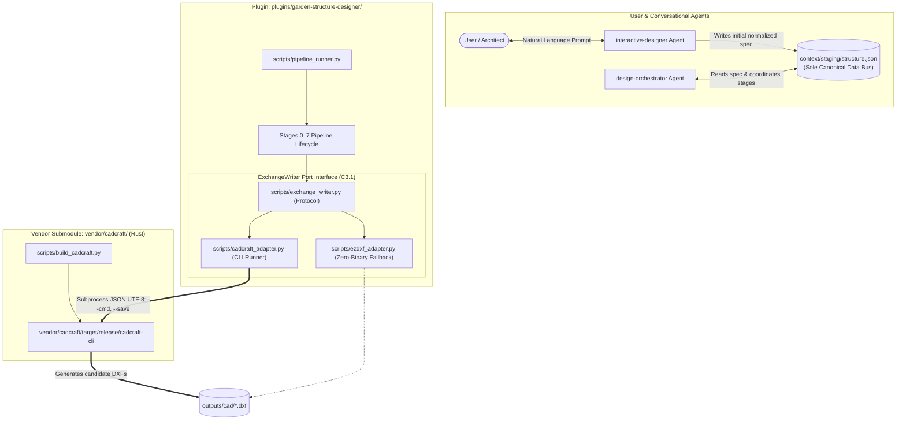

# Architecture Diagrams: CLI, Plugin, and Vendor Integration

This directory contains formal Mermaid (`.mmd`) architecture diagrams documenting the relationship between the front-door agent interface, the plugin core, the execution pipeline, and the compiled `cadcraft-cli` binary in `vendor/cadcraft/`.

---

## 1. System Topology & Boundary Map
- **File**: [`cli_plugin_vendor_architecture.mmd`](cli_plugin_vendor_architecture.mmd)
- **Description**: High-level block diagram showing the 3 distinct system layers:
  1. **User & Conversational Agents**: `interactive-designer` and `design-orchestrator`.
  2. **Plugin Architecture (`plugins/garden-structure-designer/`)**: Python authority over geometry, topology, drafting standards, `ExchangeWriter` port, and stage validators.
  3. **Vendor Submodule (`vendor/cadcraft/`)**: Rust Cargo workspace, cross-platform build tool (`build_cadcraft.py`), and the compiled release binary (`vendor/cadcraft/target/release/cadcraft-cli`).

---

## 2. Runtime Execution & Communication Sequence
- **File**: [`runtime_execution_sequence.mmd`](runtime_execution_sequence.mmd)
- **Description**: Chronological sequence diagram illustrating data flow from initial user prompt, through Python deterministic geometry calculation, out to `cadcraft-cli` subprocess drafting, through `ezdxf` parsed validation gates, and into final PDF/DXF package compilation.
