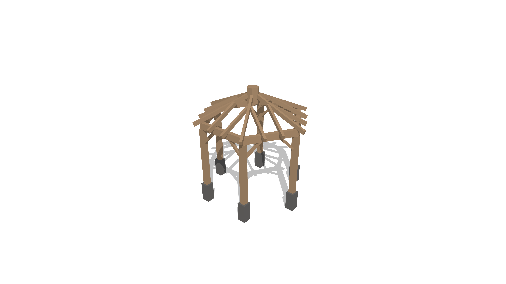
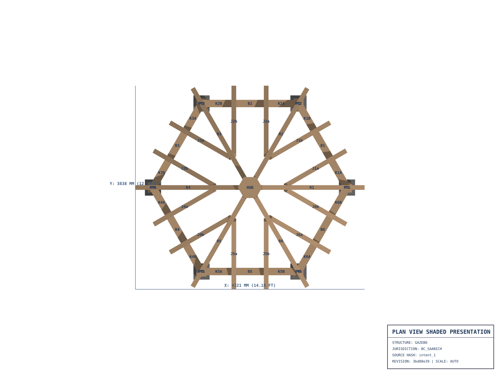
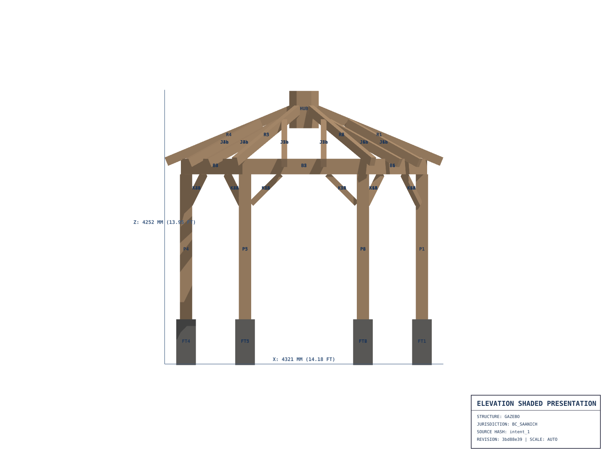
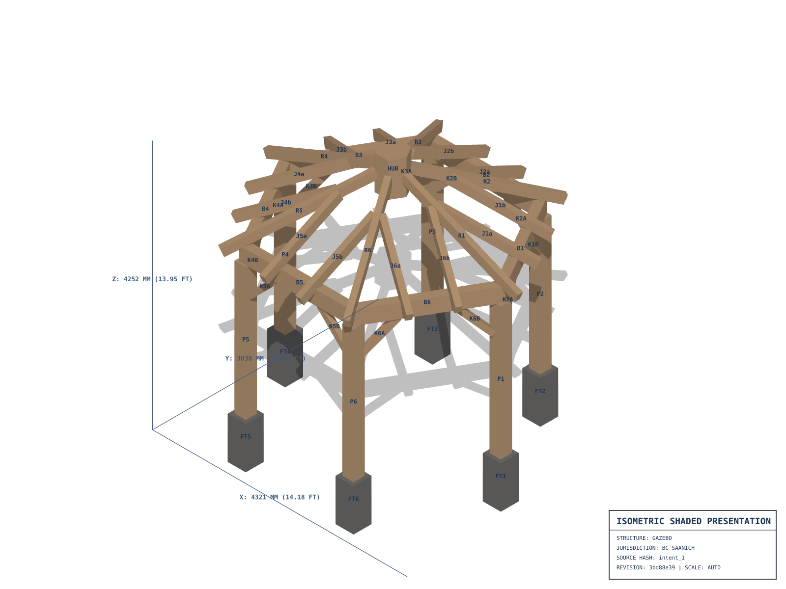
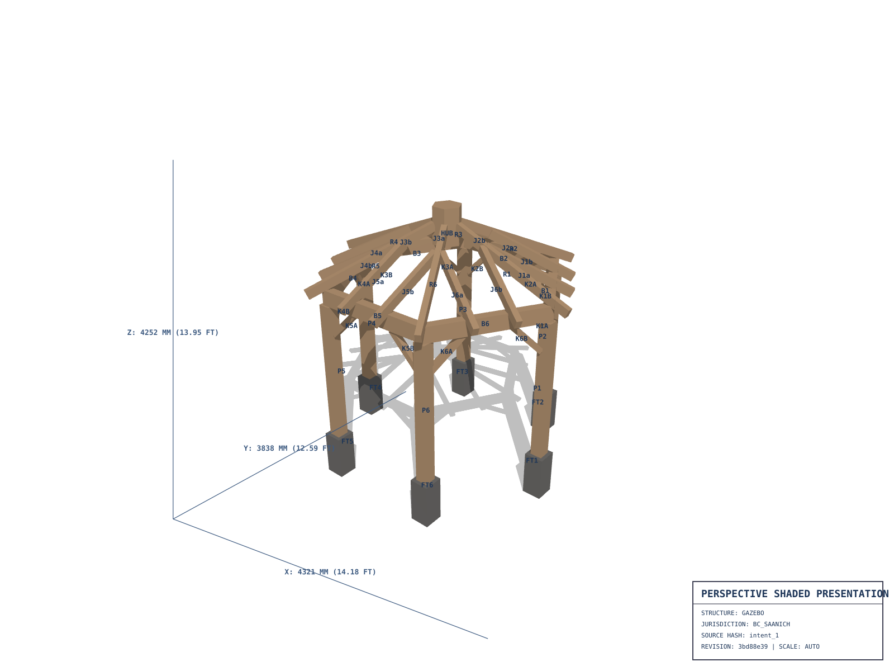
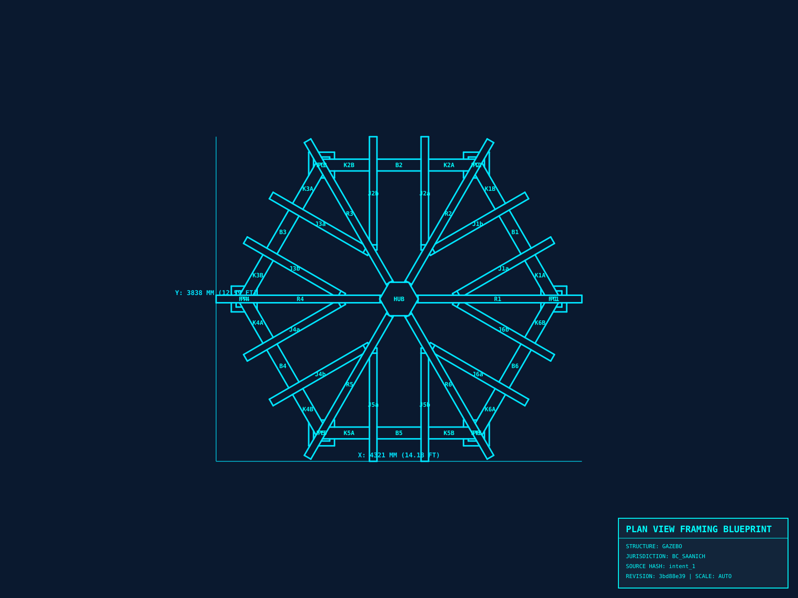
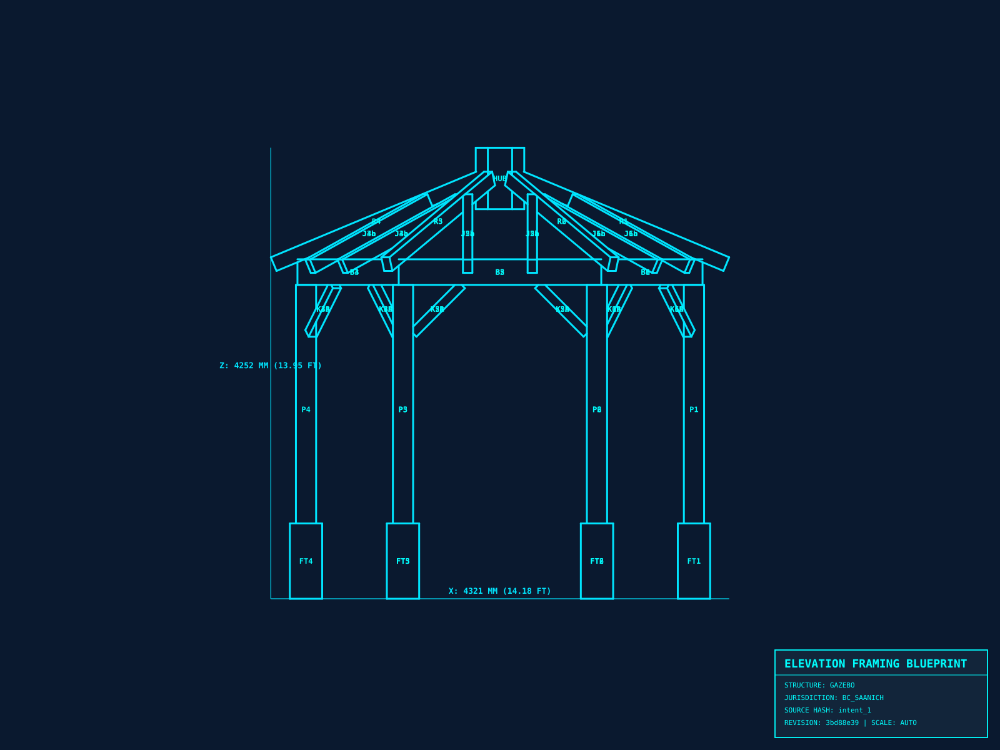
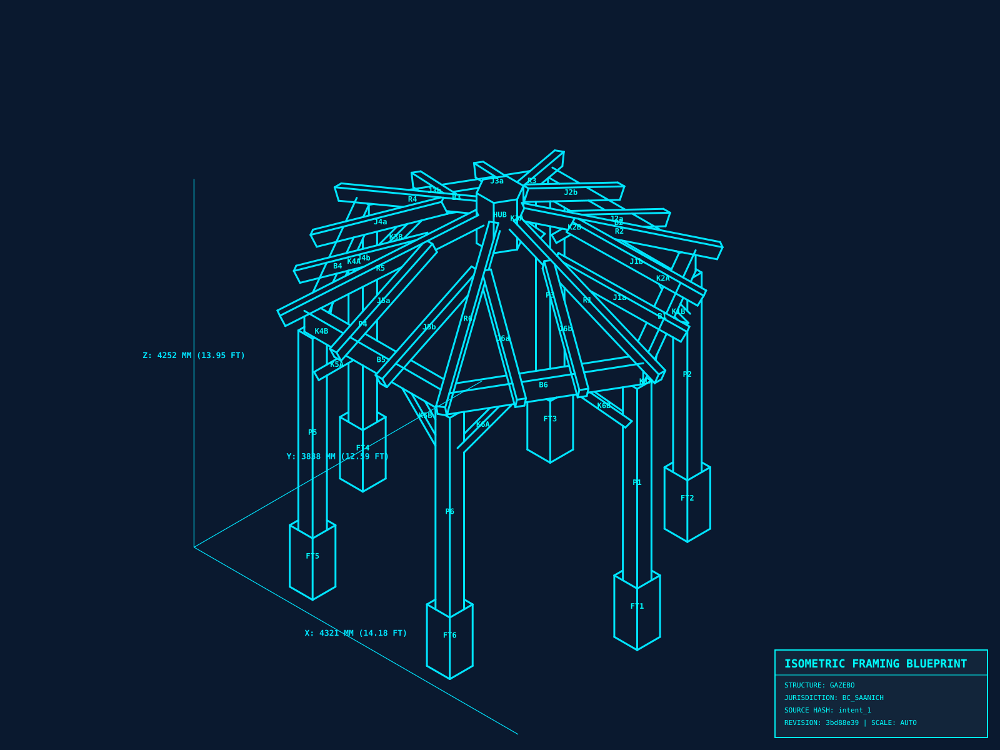
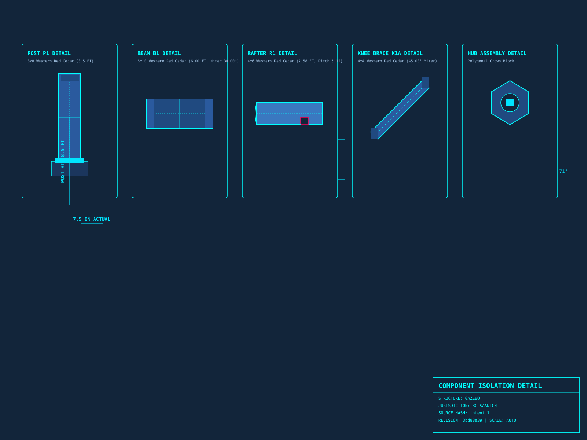

# Structural Timber Framing Construction Plan
## 12' Hexagonal Heavy-Timber Gazebo Package

**Project Location:** Saanich, BC, Canada (`BC_SAANICH`)  
**Design Standard:** BC Building Code 2024 / Part 9 Timber Framing  
**Structure Type:** 6-Post Hexagonal Heavy-Timber Gazebo with Compression Hub  
**Material Species:** Heavy Timber Western Red Cedar (Rough-Sawn)  

---

## 1. Executive Summary & Design Rationale

This structural package provides complete fabrication specifications, load-path screening, foundation schedules, and orthographic blueprints for a **12 ft hexagonal heavy-timber gazebo**. The layout features a 6-post regular polygon grid with an authentic hexagonal timber compression ring hub and paired 45° knee braces at each post.

### Core Dimensions & Specifications
- **Footprint:** 12'-0" Diameter across opposite posts (6.0 ft inscribed radius)
- **Posts (P1–P6):** 8×8 (7.5" × 7.5" actual) Western Red Cedar, 8'-6" cut length
- **Ring Beams (B1–B6):** 6×10 (5.5" × 9.5" actual) Western Red Cedar
- **Primary Rafters (R1–R6):** 4×6 (3.5" × 5.5" actual) with decorative scallop rafter tails and 1'-0" overhang
- **Compression Hub (HUB):** Hexagonal timber block with 6-face alignment
- **Lateral Knee Braces (K1A–K6B):** 4×4 (3.5" × 3.5" actual) paired 45° knee braces at post-to-beam junctions
- **Footings (FT1–FT6):** 12" diameter Sonotube concrete piers (24" depth)

---

## 2. Photorealistic Architectural Visualization

Below is the approved architectural rendering illustrating the completed 12 ft gazebo structure:

---

## 3. Architectural Drawings (Presentation Layer)

### Sheet A01 — Architectural Plan View

### Sheet A02 — Architectural Elevation View

### Sheet A03 — Isometric Overview

### Sheet A04 — Perspective Framing View

---

## 4. Orthographic Shop Blueprints (Fabrication Layer)

### Sheet S01 — Engineering Foundation & Framing Plan

### Sheet S02 — Structural Framing Elevation & Joint Miters

### Sheet S03 — Structural Isometric Assembly

### Sheet S04 — Component Isolation & Connection Details

---

## 5. Construction Package Verification

- **Cut List:** `fabrication/cut-list.json`
- **Assembly Guide:** `assembly-guide.md`
- **Lumber Purchase List:** `lumber-purchase-list.md`
- **Budget Estimate:** `budget-estimate.md`
- **CAD Exchange Deliverables:** `cad/SB01-structure.dxf`, `cad/SB02-plan.dxf`
